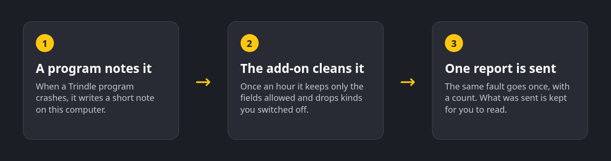

<p align="center"></p>

<p align="center">
  
  
  
  
</p>

Trindle crash reports is an optional add-on for Trindle, the Linux desktop. When one of Trindle's own programs crashes or hits an error, Trindle leaves a short note on your computer. Once an hour this add-on turns those notes into reports with nothing personal in them and sends them, so the fault can be fixed.

You choose to install it, and removing it stops everything, though its lists of what was sent and what is waiting stay in `~/.local/state/trindle/crash-reports` until you delete that folder. A report holds the program, its version and where in Trindle's code it went wrong. It never holds a message, a file name or anything about other programs, and holds your name only if you saved a Buildmorphic or GitHub name in Trindle Settings. Crashes, errors and a rough description of your computer each have their own switch in Trindle Settings.

## How it works

<p align="center"></p>

The add-on has no window of its own. Trindle Settings, under Plugins, holds the switches and lists exactly what was sent. A screenshot of that page is not included here because it belongs to the main Trindle project.

## Quick start

Build the package, then install it:

```sh
packaging/build-deb.sh
sudo apt install ./packaging/out/trindle-crash-reports_1.1.1_amd64.deb
```

The package starts an hourly timer for each signed-in user. To send what is waiting straight away:

```sh
trindle-crash-reports send
```

## Features

**Nothing personal by design.** Only these can leave your computer: the program name, its version, the signal or error code (an error goes as a crash with its code as the signal), the stack as function names and, for Trindle's own files only, a file name and line on the top one. Anything else in a note is dropped, and a stack line that does not read as a Rust function path (words joined by `::`, no free text) is dropped too. Only programs named `trindle` or `trindle-...` are reported. One word that looks like a function name cannot be told from a real one, so Trindle's own programs must not put personal text in a note. Buildmorphic refuses a whole report that has any other field.

**The same fault is sent once.** Repeats in the same hour are not sent again, and Buildmorphic counts the same fault from different reports itself.

**Each report goes to the right repository.** A crash in a program that has its own repository goes there, and everything else goes to `trindle`. The add-on asks Buildmorphic whether it is taking reports for that repository first, and keeps the report waiting if not.

**Each kind has a switch.** Crashes, errors and the computer description can each be turned off. Reports waiting for a kind you turn off are thrown away.

**Retries, then gives up.** If Buildmorphic is not taking reports or cannot be reached, a report is tried again each hour for up to a day. A report Buildmorphic refuses is dropped.

**A record you can read.** The last 50 reports sent are kept on your computer so Trindle Settings can show them exactly as they went.

## What it does

- Reads Trindle's crash and error notes once an hour and sends the ones switched on.
- Sends nothing when run as the root user.
- Sends no more than one batch every 55 minutes.
- Sends over HTTPS only, using `curl`.
- Can add a rough description of the computer, as text with a one-line summary first: system and version, processor type, memory, graphics maker, session type and screen count (capped at four). It is off if you switch it off.
- Adds your Buildmorphic username and GitHub name if you saved them in Trindle Settings, so you can be credited for a fix. Without them, reports carry no name. Never an email address.

## Settings

The switches live in `~/.config/trindle/crash-reports.json`, which Trindle Settings writes. You do not need to edit it by hand.

| Name | Required | Default | What it does |
|---|---|---|---|
| `crashes` | no | `true` | Send reports of crashes (signals, panics, running out of memory). |
| `errors` | no | `true` | Send reports of Trindle error codes. |
| `computer` | no | `true` | Add the rough description of this computer to each report. |

## Where your data lives

Everything stays under your home folder until it is sent:

| Path | Holds |
|---|---|
| `~/.config/trindle/crash-reports.json` | The three switches. |
| `~/.local/state/trindle/crash-notes.jsonl` | Notes left by Trindle's programs. |
| `~/.local/state/trindle/crash-reports/waiting.json` | Reports waiting to be sent. |
| `~/.local/state/trindle/crash-reports/sent.jsonl` | The last 50 reports sent. |

It also reads `report_username` and `report_github` from `~/.config/trindle/trindle.conf`, where Trindle Settings saves them. It never changes that file.

Reports go to `https://buildmorphic.com/api/reports/<repository>`. There is no key or account.

## Security

The add-on only reads notes that Trindle's programs wrote, checks every field against a fixed list, and writes its own files readable only by you. To report a security problem privately, see [SECURITY.md](SECURITY.md).

## Building it yourself

You need Rust 1.85 or newer and `curl` at run time.

```sh
cargo build --release
cargo test
```

The binary is `target/release/trindle-crash-reports`. `packaging/build-deb.sh` builds the Debian package into `packaging/out/`.

## Licence

Trindle crash reports is free software under the GNU General Public License, version 3 or later, copyright the Trindle project. The full text is in [LICENSE](LICENSE). Changes for each version are in [CHANGELOG.md](CHANGELOG.md). To help, see [CONTRIBUTING.md](CONTRIBUTING.md).

Comments are stripped from the published code to keep it lean.

## Disclaimer

This software is provided as it is, without warranty of any kind. See the licence for the details.
